# Space Fractions: Architecture Views

## 1. Scenario View (Use Cases)

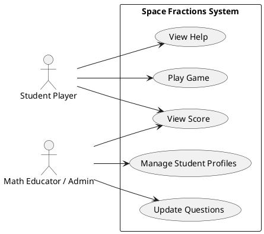

## 2. Logic View (Class & Object Diagrams)

### Class Diagram
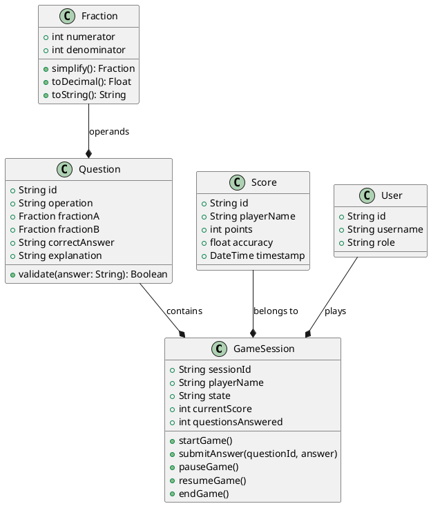

### Object Diagram
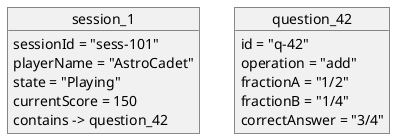

## 3. Process View (State, Activity, Sequence & Collaboration)

### State Diagram
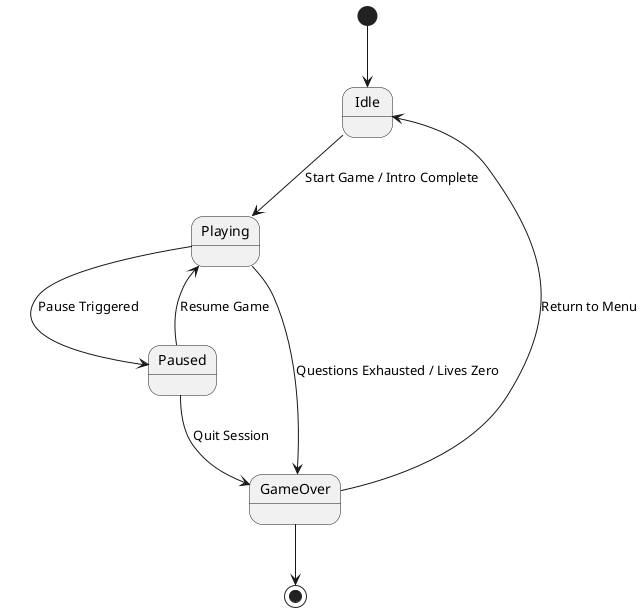

### Activity Diagram
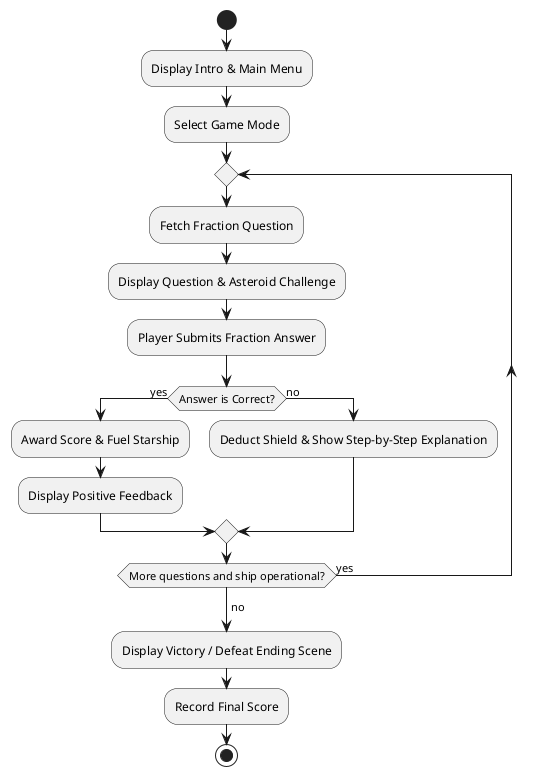

### Sequence Diagram
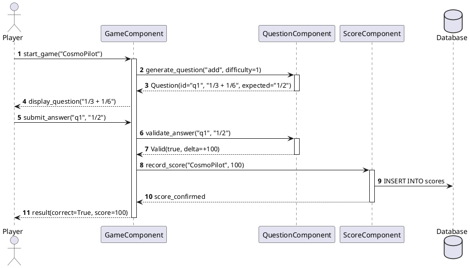

### Collaboration Diagram
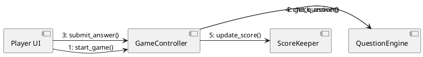

## 4. Development View (Package & Component Diagrams)

### Package Diagram
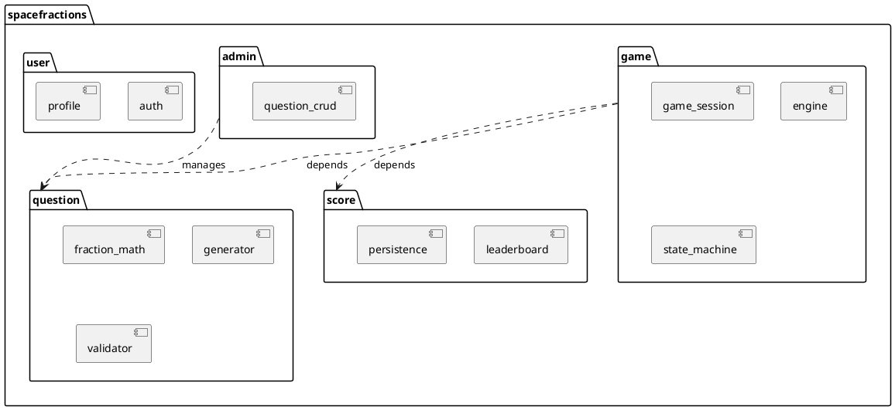

### Component Diagram
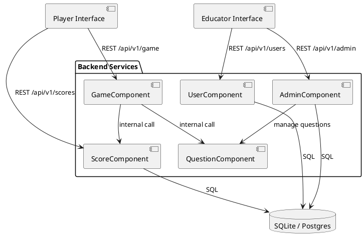

## 5. Physical View (Deployment & Container Diagrams)

### Deployment Diagram
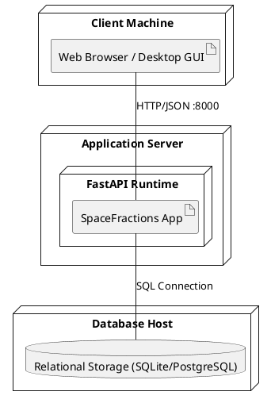

### Container Diagram (C4 Style)
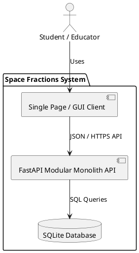
